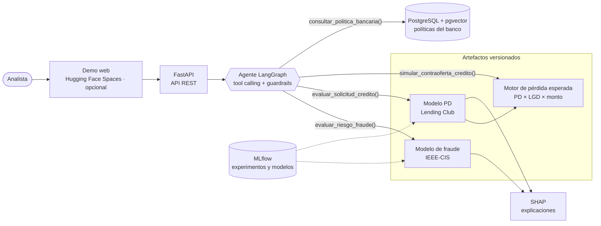
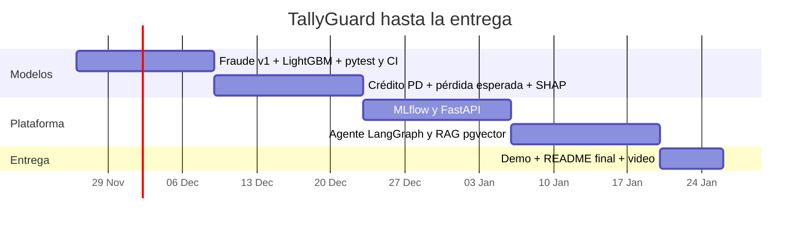

<!--
  Pendientes del README:
  - Cambiar el badge de CI por el real de GitHub Actions cuando exista .github/workflows/ci.yml.
  - Cambiar el badge de licencia cuando el equipo elija una y se agregue el archivo LICENSE.
  - Agregar el enlace del demo cuando haya un despliegue que funcione.
  - Llenar las tablas de resultados con métricas reales del repo.
-->

<div align="center">


**Un solo agente. Dos dominios críticos de la banca. Cero montos inventados.**

Detección de fraude transaccional y evaluación de crédito con modelos explicables,<br/>
orquestados por un agente con *tool calling* que cita la política del banco antes de decidir.

<br/>

[](https://www.python.org/)
[](https://docs.astral.sh/uv/)
[](https://scikit-learn.org/)
[](#cronograma)
[-lightgrey)](https://docs.astral.sh/ruff/)
[](#licencia)
[](#cronograma)
[](#cronograma)

[Visión](#visión) · [Arquitectura](#arquitectura) · [Capacidades](#capacidades) · [Monto seguro](#cómo-se-calcula-el-monto-seguro) · [Resultados](#resultados) · [Cronograma](#cronograma) · [Instalación](#cómo-correrlo)

</div>

---

> [!NOTE]
> **Proyecto en construcción, documentado con honestidad.** TallyGuard es el proyecto final del
> **Samsung Innovation Campus** (IA), con entrega el **26 de enero de 2027**. Cada fila de este README
> indica si algo está **hecho**, **en progreso** o **planeado**. Las métricas solo aparecen
> cuando salen de un experimento reproducible del repositorio.

## Visión

Los bancos operan fraude y crédito como silos. Un analista que revisa una transacción sospechosa y
luego una solicitud de préstamo del mismo cliente salta entre sistemas, reglas y criterios distintos.

**TallyGuard** propone un copiloto único que:

1. **Detecta fraude** en transacciones con clases muy desbalanceadas, cuidando tanto la pérdida por
   fraude como el costo de bloquear a un cliente legítimo.
2. **Evalúa crédito**: estima la probabilidad de impago (PD), calcula la **pérdida esperada** y
   propone el **monto máximo seguro** que respeta la política de riesgo, con contraofertas *what-if*.
3. **Explica y cita**: cada decisión viene con los factores que la movieron (SHAP) y la regla de
   la política interna que la respalda (RAG).

La regla de diseño más importante: **el LLM no calcula nada.** Enruta, valida entradas y traduce a
lenguaje de negocio. Toda probabilidad y todo monto sale de un modelo versionado o de una fórmula
auditable.

## Arquitectura



**Principios de arquitectura**

| Principio | Qué significa en el código |
|---|---|
| Dominios separados | Fraude y crédito nunca comparten tabla ni modelo. Cada uno se registra en MLflow con sus métricas, parámetros y metadatos. |
| Sin fuga de datos | Todo preprocesamiento (imputación, escalado, IQR) vive dentro de un `Pipeline` y se ajusta solo en los *folds* de entrenamiento. |
| Validación temporal | En fraude, la partición respeta el orden del tiempo (`TransactionDT`); no se mezclan transacciones futuras en el entrenamiento. |
| El LLM no inventa números | Las herramientas devuelven valores tipados; el agente solo puede repetirlos. Un set de evaluación lo verifica. |
| Política como fuente de verdad | Los umbrales de aprobación viven en el documento de políticas, no en el *prompt*. |

## Capacidades

| Área | Capacidad | Estado |
|---|---|:---:|
| **Entorno** | Python 3.12 con `uv` y `uv.lock` reproducible | Hecho |
| | Estructura de carpetas `data/ models/ notebooks/ src/ tests/` | Hecho |
| | Guía de descarga de IEEE-CIS en `data/raw/` | Hecho |
| **Fraude** | EDA del dataset IEEE-CIS | Planeado |
| | Partición temporal y pipeline sin fuga de datos | Planeado |
| | Modelos del curso: Regresión logística, Árbol, KNN, SVC, Random Forest | Planeado |
| | **LightGBM** como baseline fuerte de referencia | Planeado |
| | Umbral de decisión elegido por costo (fraude perdido vs. cliente bloqueado) | Planeado |
| | Búsqueda de hiperparámetros con Optuna | Planeado · opcional |
| **Crédito** | Modelo de PD entrenado con **todos** los préstamos cerrados | Planeado |
| | Pérdida esperada `PD × LGD × monto` y monto seguro por política | Planeado |
| | Contraofertas *what-if* (monto, plazo) | Planeado |
| **Explicabilidad** | SHAP global y por predicción | Planeado |
| **MLOps** | Seguimiento de experimentos y registro de modelos con MLflow | Planeado |
| **Agente** | Agente en LangGraph con 4 herramientas tipadas | Planeado |
| | RAG sobre políticas con pgvector y cita de documento, página y versión | Planeado |
| | Set de evaluación: el agente nunca inventa montos ni probabilidades | Planeado |
| **Ingeniería** | Pruebas con `pytest` | Planeado |
| | CI en GitHub Actions con `ruff` + `pytest` | Planeado |
| | API con FastAPI | Planeado |
| | Contenedor Docker | Planeado · opcional |
| | Demo pública en Hugging Face Spaces | Planeado · opcional |
| | Video corto de demostración | Planeado |

## Cómo se calcula el monto seguro

Esta es la decisión de diseño central del dominio de crédito.

**Enfoque descartado.** Entrenar una regresión del monto (`loan_amnt`) usando solo los préstamos
`Fully Paid`. Ese modelo aprende *cuánto le prestaban a la gente que pagó*, no *cuánto se le puede
prestar a alguien sin exceder el riesgo*. Imita decisiones pasadas del banco en lugar de medir riesgo.

**Enfoque adoptado.** Separar la estimación de riesgo de la decisión de negocio:

1. **Modelo de PD** entrenado con *todos* los préstamos cerrados de Lending Club
   (`Charged Off` = 1, `Fully Paid` = 0), con el monto solicitado como variable de entrada.
2. **Pérdida esperada** para un monto candidato *M*:

   ```text
   EL(M) = PD(cliente, M) × LGD × M
   ```

   donde **LGD** (pérdida dado el incumplimiento) se estima a partir de las recuperaciones
   observadas en los préstamos `Charged Off` o se fija como supuesto explícito y documentado.
3. **Monto seguro** = el mayor *M* que cumple el umbral de la política del banco, por ejemplo
   `EL(M) / M ≤ pérdida máxima tolerada` o `PD(cliente, M) ≤ PD máxima`. El umbral se lee del
   documento de políticas, no se fija en el código.
4. **Contraoferta**: si el monto solicitado no cumple, el sistema busca el mayor monto (o el plazo)
   que sí cumple y lo presenta con su PD y su pérdida esperada.

> [!WARNING]
> **Sesgo de rechazo (*reject inference*).** Lending Club solo publica préstamos que **fueron
> aprobados**. El modelo nunca ve a los solicitantes rechazados, así que su PD puede subestimar el
> riesgo de perfiles que el banco original no habría aprobado. TallyGuard no corrige este sesgo en
> esta entrega; lo declara, limita las recomendaciones a rangos vistos en entrenamiento y lo deja como
> trabajo futuro.

## Resultados

> [!IMPORTANT]
> Las tablas están vacías a propósito. Se llenan en la última semana solo con resultados reproducibles
> desde el repo (corrida de MLflow o script indicado en cada fila), con la misma partición y semilla
> para todos los modelos.

### Fraude (IEEE-CIS, partición temporal)

| Modelo | PR-AUC | ROC-AUC | Recall @ umbral elegido | Precisión @ umbral elegido | Fuente |
|---|:---:|:---:|:---:|:---:|---|
| Regresión logística | — | — | — | — | pendiente |
| Árbol de decisión | — | — | — | — | pendiente |
| KNN | — | — | — | — | pendiente |
| SVC | — | — | — | — | pendiente |
| Random Forest | — | — | — | — | pendiente |
| **LightGBM (baseline)** | — | — | — | — | pendiente |

*Se usa PR-AUC como métrica guía porque la clase de fraude es minoritaria y la exactitud
(accuracy) no informa nada útil en ese escenario.*

### Crédito (Lending Club, préstamos cerrados)

| Modelo de PD | ROC-AUC | Brier score | Calibración | Fuente |
|---|:---:|:---:|:---:|---|
| Regresión logística | — | — | — | pendiente |
| Random Forest | — | — | — | pendiente |
| **LightGBM (baseline)** | — | — | — | pendiente |

### Agente

| Prueba | Casos | Aprobados | Fuente |
|---|:---:|:---:|---|
| No inventa montos ni probabilidades | — | — | pendiente |
| Cita la política correcta | — | — | pendiente |

## Cronograma

Plan de trabajo hasta la entrega del **26 de enero de 2027**.

| Semanas | Hasta | Entregable | Estado |
|---|---|---|:---:|
| **1–2** | 9 dic 2026 | Fraude v1: partición temporal, pipeline sin fuga, modelos del curso + LightGBM, pruebas con pytest y CI con ruff en GitHub Actions | En progreso |
| **3–4** | 23 dic 2026 | Crédito: modelo de PD, pérdida esperada y monto seguro; explicaciones con SHAP en ambos dominios | Planeado |
| **5–6** | 6 ene 2027 | MLflow para experimentos y registro de modelos; API con FastAPI | Planeado |
| **7–8** | 20 ene 2027 | Agente en LangGraph y RAG con pgvector, con su set de evaluación | Planeado |
| **Última** | 26 ene 2027 | Demo desplegado, README final con métricas reales y video corto | Planeado |

Opcionales si el calendario lo permite: Docker, demo en Hugging Face Spaces y búsqueda de
hiperparámetros con Optuna.



## Decisiones y limitaciones

**Decisiones**

- **LightGBM como referencia, no como reemplazo.** Los modelos del curso se comparan contra un
  baseline de gradient boosting, que es el estándar en datos tabulares, para saber qué tan lejos
  o cerca están.
- **Umbral por costo, no por 0.5.** En fraude, el punto de corte se elige según el costo relativo
  de un fraude no detectado frente a un cliente bloqueado sin razón.
- **Muestreo estratificado para iterar.** IEEE-CIS es grande; para iterar en local se usa una
  muestra que conserva la proporción real de fraude. Los resultados finales indican el tamaño usado.

**Limitaciones conocidas**

- Sesgo de rechazo en Lending Club (ver [monto seguro](#cómo-se-calcula-el-monto-seguro)).
- Los datos de IEEE-CIS están anonimizados; muchas variables no tienen significado de negocio
  explícito, lo que limita la interpretación de SHAP.
- La LGD es una estimación agregada, no un modelo por cliente.
- Quedan fuera de esta entrega la detección de anomalías, la segmentación de clientes, las señales
  de texto y las redes neuronales. Son trabajo futuro.
- Es un proyecto académico y de portafolio. No es un sistema de decisión crediticia real ni
  sustituye la revisión humana.

## Cómo correrlo

**Requisitos:** Python 3.12 y [`uv`](https://docs.astral.sh/uv/getting-started/installation/).

```bash
git clone https://github.com/ChildishTitan90/TallyGuard.git
cd TallyGuard
uv sync --locked
```

Comprueba el entorno:

```bash
uv run --locked python -c "import pandas, sklearn, joblib; print('Entorno listo')"
```

**Datos de fraude.** Descarga los archivos de
[IEEE-CIS Fraud Detection](https://www.kaggle.com/competitions/ieee-fraud-detection/data) y
colócalos en `data/raw/` con sus nombres originales:

| Archivo | Uso |
|---|---|
| `train_transaction.csv` | Transacciones etiquetadas con `isFraud`. Base de la exploración y de la partición temporal. |
| `train_identity.csv` | Datos de identidad, se unen por `TransactionID`. |
| `test_transaction.csv`, `test_identity.csv` | Evaluación de Kaggle. La prueba interna se reserva dentro de `train_transaction.csv`. |
| `sample_submission.csv` | Plantilla de entrega de la competencia. |

**Datos de crédito.** Pendiente. Se documentará al iniciar el dominio de crédito (Lending Club, préstamos cerrados).

Git ignora los datos originales, los datos procesados y los modelos generados.

<details>
<summary><b>Próximamente: pruebas, MLflow, API y Docker</b></summary>

Estos comandos se activan cuando existan las piezas correspondientes:

```bash
uv run pytest                         # pruebas
uv run ruff check .                   # lint
uv run mlflow ui                      # experimentos (MLflow)
uv run uvicorn tallyguard.api:app     # API (FastAPI)
docker build -t tallyguard .          # contenedor (opcional)
```

</details>

## Estructura del proyecto

```text
tallyguard/
├── data/
│   ├── raw/          CSV originales (ignorados por git)
│   ├── processed/    muestras y particiones generadas
│   └── docs/         políticas del banco para el RAG
├── models/           artefactos de modelos y metadatos
├── notebooks/        exploración y experimentos
├── src/              código reutilizable de preparación y entrenamiento
├── tests/            pruebas
├── pyproject.toml    dependencias (uv)
├── uv.lock           versiones exactas
├── Dockerfile        contenedor  (planeado, opcional)
└── .github/workflows CI con ruff + pytest  (planeado)
```

*Lo marcado como (planeado) aún no existe. Las carpetas creadas todavía están vacías.*

## Stack

| Capa | Herramientas | Estado |
|---|---|:---:|
| Lenguaje y entorno | Python 3.12, uv | Hecho |
| Datos y ML clásico | pandas, scikit-learn, joblib | Instalado |
| Boosting y explicabilidad | LightGBM, SHAP | Planeado |
| Calidad | pytest, ruff, GitHub Actions | Planeado |
| Experimentos y modelos | MLflow | Planeado |
| Servicio | FastAPI | Planeado |
| Agente y RAG | LangGraph, pgvector | Planeado |
| Opcionales | Docker, Hugging Face Spaces, Optuna | Planeado · opcional |

## Equipo y créditos

Proyecto en equipo desarrollado como proyecto final del
**Samsung Innovation Campus**.

| Integrante | GitHub |
|---|---|
| Víctor Antonio Hernández Paredes | [ChildishTitan90](https://github.com/ChildishTitan90) |
| Apolo | [OscarrGv](https://github.com/OscarrGv) |

**Datos:** [IEEE-CIS Fraud Detection](https://www.kaggle.com/competitions/ieee-fraud-detection)
(Vesta Corporation e IEEE Computational Intelligence Society, vía Kaggle) y Lending Club Loan Data
(Kaggle). Cada dataset conserva su propia licencia y términos de uso.

## Licencia

Por definir por el equipo. Hasta que exista un archivo `LICENSE`, todos los derechos quedan
reservados a sus autores.

<div align="center">
<br/>
<sub>Hecho con rigor, por capítulos, en el Samsung Innovation Campus.</sub>
</div>
